<div align="center" dir="rtl">


# نور — Noor

**تطبيق إسلامي متكامل بتصميم زجاجي فاخر · A premium liquid-glass Islamic app (Flutter, Arabic RTL)**

[](https://github.com/bileldh-ing/islamic_app_nour/actions/workflows/ci.yml)
[](https://github.com/bileldh-ing/islamic_app_nour/actions/workflows/demo.yml)

**[▶ جرّب النسخة التجريبية على الويب · Live web demo](https://bileldh-ing.github.io/islamic_app_nour/?demo)**

</div>

## 🎬 Demo

<div align="center">


[Full-quality video (MP4)](docs/media/demo.mp4)
</div>

## 📱 Screenshots

| الرئيسية · Home | القبلة · Qibla | القرآن · Quran | الفاتحة · Reader |
|:-:|:-:|:-:|:-:|
| 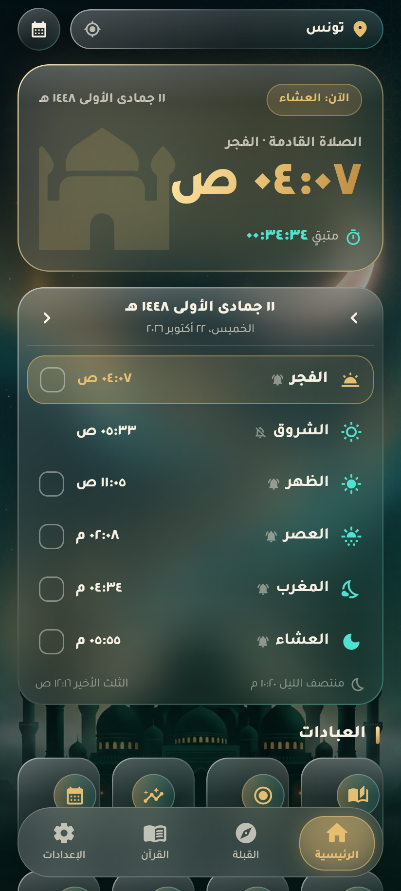 | 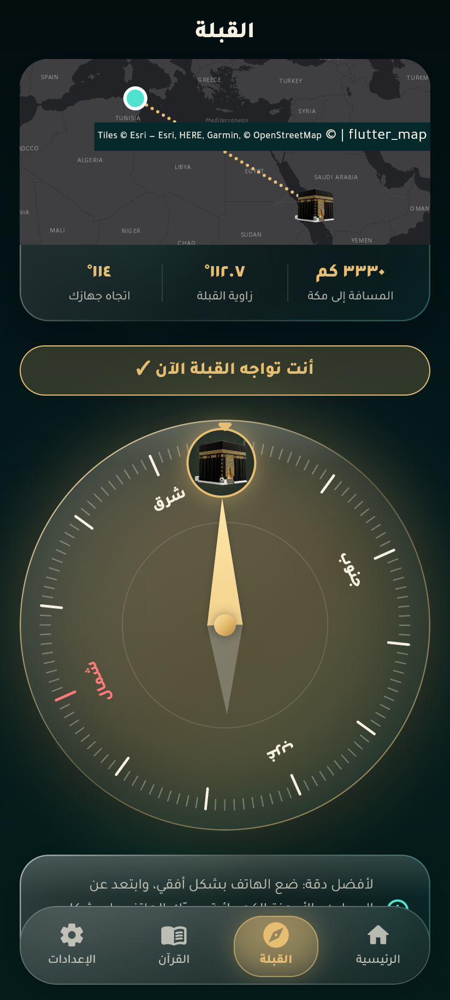 | 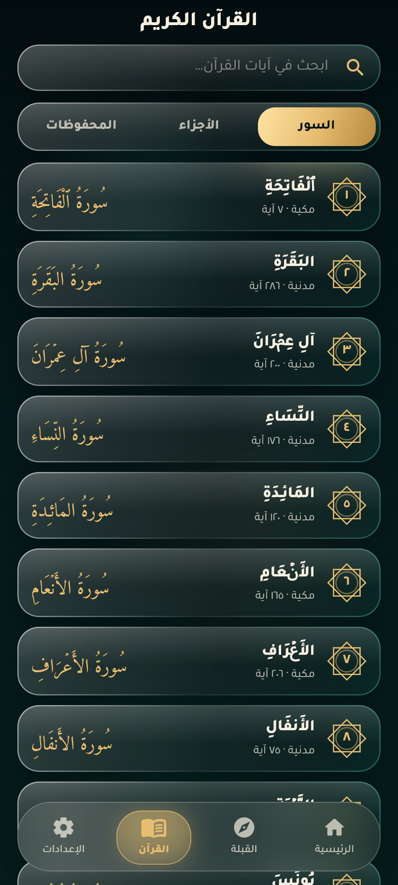 | 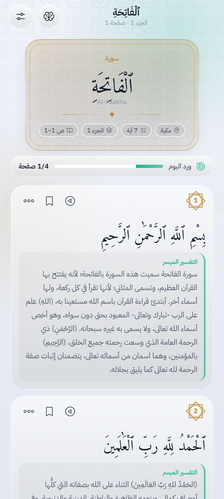 |
| **يس · Ya-Sin** | **الأذكار · Azkar** | **الأدعية · Duas** | **التسبيح · Tasbih** |
|  | 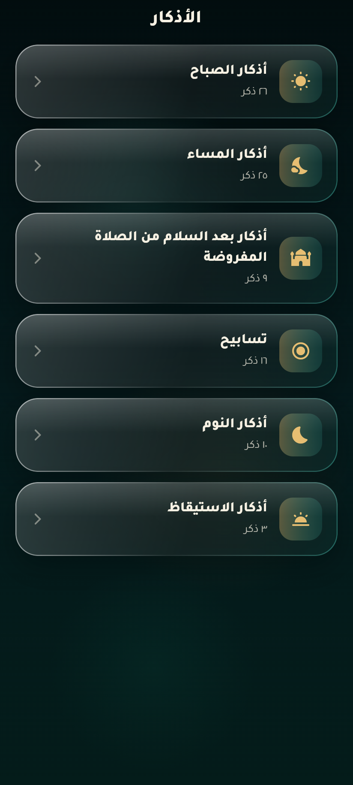 | 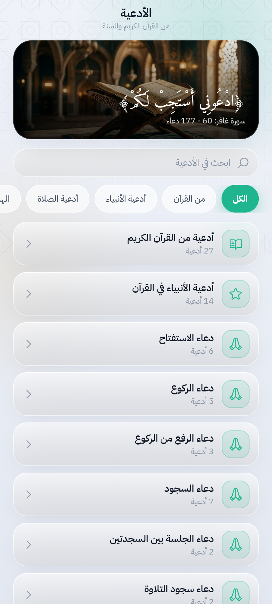 | 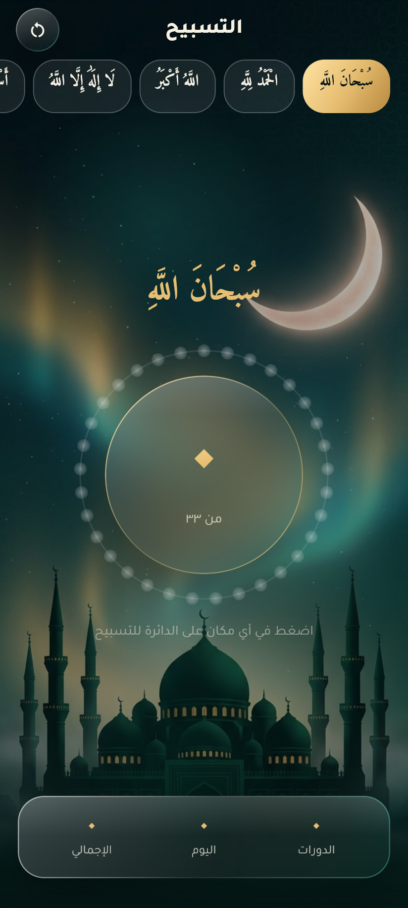 |
| **متابعة الصلاة · Tracker** | **التقويم الهجري · Hijri** | **أسماء الله الحسنى · 99 Names** | **الصيام · Fasting** |
| 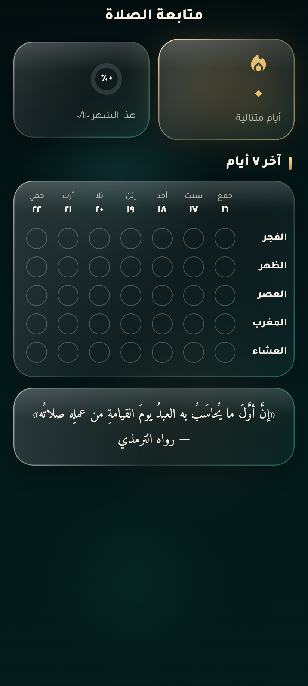 | 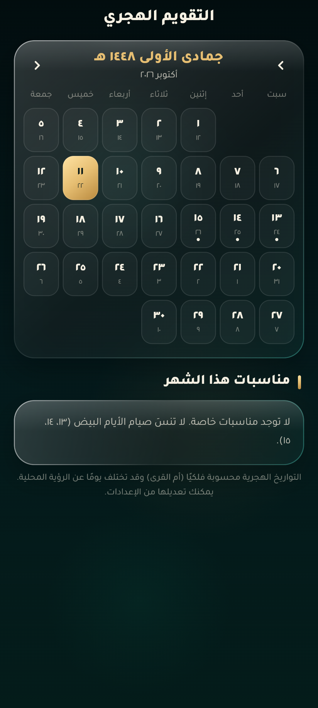 | 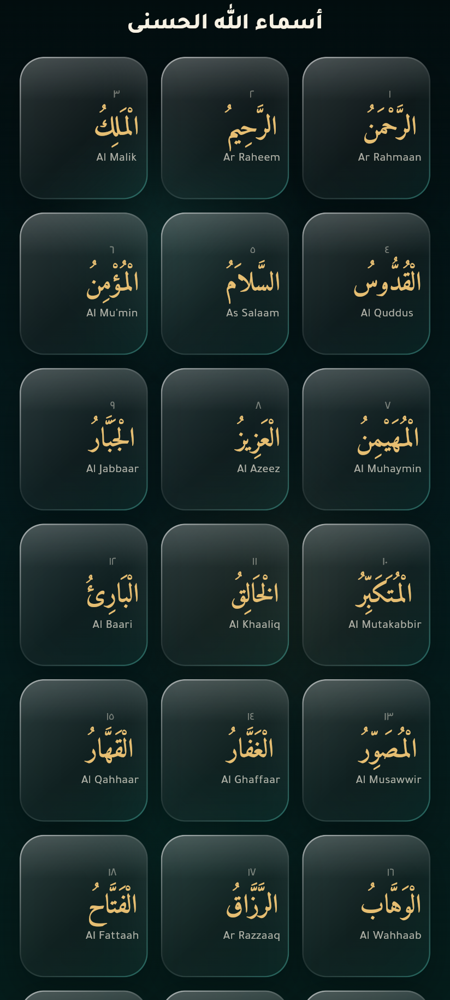 | 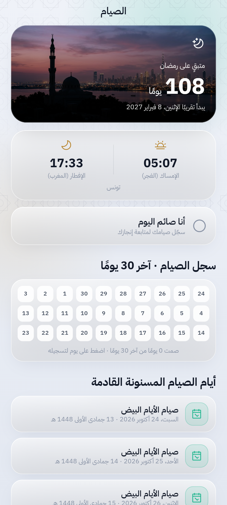 |
| **الشهادة · Shahada** | **الإعدادات · Settings** | **البداية · Onboarding** | |
| 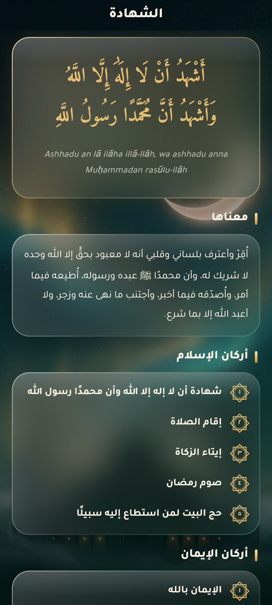 | 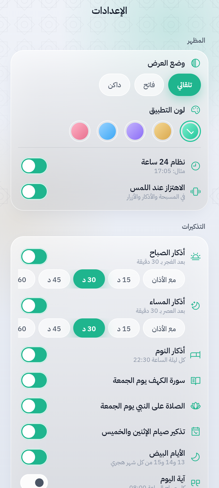 | 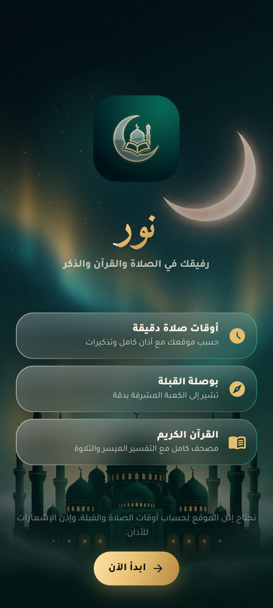 | |

> Screenshots and the demo are captured automatically from the real app by the `demo.yml` workflow on every change.

## ✨ Features
- **مواقيت الصلاة** — precise times via `adhan_dart`, GPS, 19 calculation methods, madhab & high-latitude rules, per-prayer minute adjustments
- **الأذان والتنبيهات** — Athan notifications, pre-prayer reminders, morning/evening azkar, Friday Al-Kahf, fasting reminders
- **القبلة** — live compass with smoothing and haptic lock, plus a map route and distance to the Kaaba
- **القرآن الكريم** — fully offline: 114 surahs, 6,236 ayahs in Uthmani script, Tafsir al-Muyassar, optional English/French translations, six reciters, search, juz index, bookmarks, reading progress
- **حصن المسلم** — authentic azkar with counters, Quranic & prophetic duas
- **التسبيح، متابعة الصلاة، التقويم الهجري، أسماء الله الحسنى، الصيام، الشهادة**
- Fully Arabic, right-to-left, liquid-glass midnight teal / emerald / gold design

## 🛠 Build
```bash
flutter pub get
dart run flutter_launcher_icons
flutter run
```

## 🚀 CI/CD
- `ci.yml` — analyze, tests + coverage, Android APK, iOS build on every push/PR
- `release.yml` — tag `vX.Y.Z` → signed AAB/APK, GitHub Release, Google Play internal track, TestFlight
- `demo.yml` — web build, real screenshots, demo video, GitHub Pages live demo

Secrets and store setup: [docs/RELEASE.md](docs/RELEASE.md)
